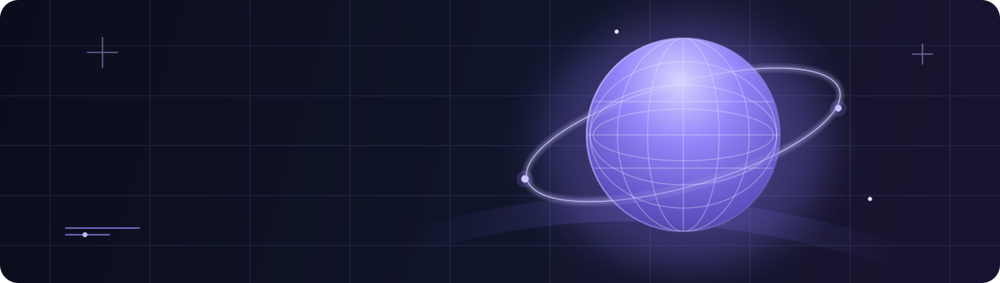
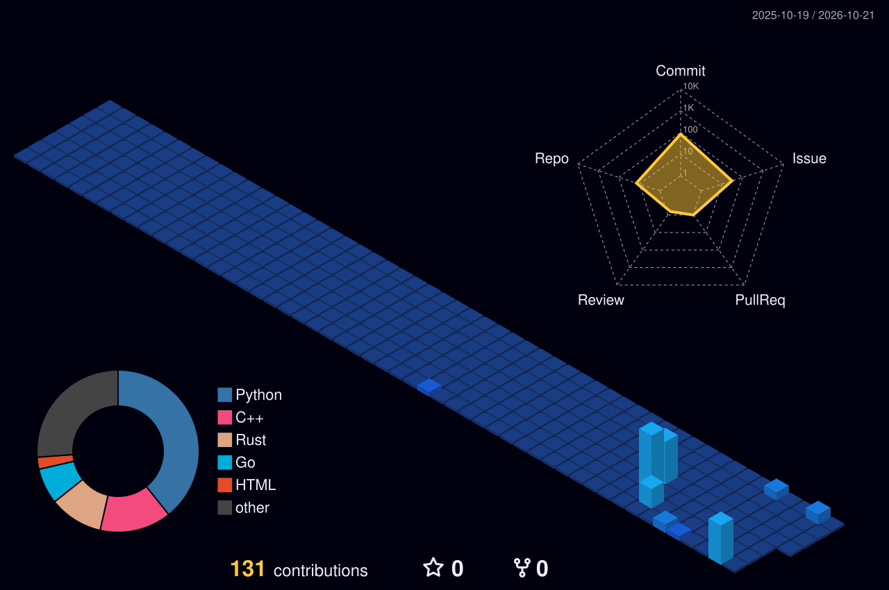

  
   
  

  # Hey, I'm Nova 👋

  **Developer in progress · Curious builder · Lifelong learner**

  I enjoy learning how software works, building useful things, and exploring what web development and AI can make possible.

  

    <a href="#about-me">About me</a> ·
    <a href="#what-im-about">What I'm about</a> ·
    <a href="#skills">Skills</a> ·
    <a href="#learning-journey">Learning journey</a> ·
    <a href="#connect">Connect</a>
  

---

## About me

Hey! I'm Nova. I'm a self-driven learner interested in software development, web technologies, and practical AI tools. I like taking an idea, figuring out how it could work, and improving it step by step.

I'm still learning, and that's part of the point: understand the fundamentals, build things that are useful, and get a little better with every iteration.

## What I'm about

- **Curiosity first:** explore how things work instead of stopping at the surface.
- **Build to learn:** turn concepts into small, practical experiments.
- **Useful technology:** focus on tools and experiences that solve real problems.
- **Keep improving:** welcome feedback, learn from mistakes, and refine the work.

## Skills

### Web development

  
  
  
  

### Programming and tools

  
  
  
  
  

I'm continuing to deepen these skills through practice. The badges show my current areas of focus, not a claim that I've mastered every tool.

## Learning journey

| Focus | What I'm working toward |
| --- | --- |
| **Web foundations** | Stronger HTML, CSS, JavaScript, and responsive UI skills |
| **Full-stack basics** | Connecting interfaces with APIs and backend tools |
| **AI and automation** | Understanding API integrations and making helpful workflows |
| **Engineering habits** | Better debugging, readable code, Git, testing, and steady iteration |

My approach is simple: **learn → build → test → improve**.

## 3D GitHub activity

Want the real scroll-controlled 3D experience? <a href="https://nova-spectre777.github.io/nova-spectre777/">Open the interactive profile</a>. This contribution calendar is a separate GitHub activity visual and refreshes automatically via GitHub Actions.

  

## Connect

I'm always glad to meet people who enjoy learning, sharing ideas, and building useful things.

  
  &nbsp;
  

    

  **Stay curious. Make it useful. Keep improving.**

